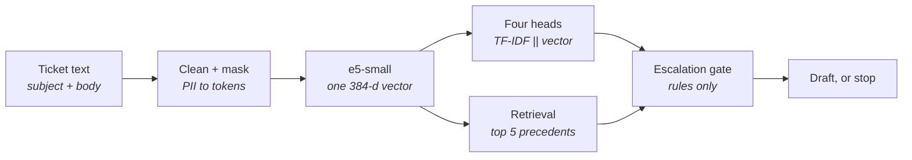
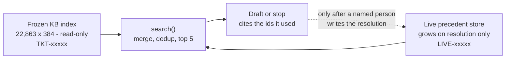

# SentinelDesk — architecture

Multilingual incident triage with precedent-grounded drafting. A ticket arrives, gets
classified, matched against resolved history, and either answered with citations or stopped
at a gate that can explain itself.

**Dataset:** `aa_dataset-tickets-multi-lang-5-2-50-version.csv` — 28,587 tickets, EN/DE,
official seed-42 80/20 split → 22,863 KB rows (7 answerless rows dropped) / 5,718 holdout.

---

## 1. One encoder, three jobs

A single 384-dimension vector per ticket serves as the classifier's feature, the retrieval
query, and — over the KB — the index itself. No second model to load, no duplicated compute,
and cross-lingual capability arrives free with a multilingual encoder.



The gate sees both the classifier's confidences and the retrieval scores before deciding.
No model is consulted for the decision itself.

### Module map

| Path | Role |
|---|---|
| `src/sentineldesk/data.py`, `text.py` | Loading, cleaning, the leakage-safe split |
| `src/sentineldesk/embed.py` | e5 encoder, `query:` / `passage:` prefixes |
| `src/sentineldesk/classify.py` | Four logistic-regression heads |
| `src/sentineldesk/retrieve.py` | Index build, search, live-store append |
| `src/sentineldesk/gate.py` | Escalation rules |
| `src/sentineldesk/generate.py` | Prompt, verification, extractive fallback |
| `src/sentineldesk/pipeline.py` | `triage()`, `resolve_ticket()` |
| `api/main.py` | FastAPI backend: runs `triage()`, holds the tickets, serves the admin console and the customer site |
| `api/assignment_rules.py` | Editable routing rules applied after the model's prediction |

---

## 2. The ML side

Four logistic-regression heads over `[word TF-IDF ‖ e5 embedding]`, `C=32`,
`class_weight="balanced"`. Every setting chosen on a 10% KB validation slice; the holdout
was evaluated once, on the frozen model.

| Head | Macro-F1 | Accuracy | ECE |
|---|---:|---:|---:|
| type | 0.8777 | 0.8692 | 0.028 |
| queue | 0.6109 | 0.6142 | 0.012 |
| priority | 0.6195 | 0.6366 | 0.082 |
| language | 0.9666 | 0.9675 | 0.003 |

High-priority Incident recall: **0.8523** on priority alone, **0.7729** on priority and type
together (support 995).

**Why queue sits at 0.61.** Ten classes at 21× imbalance, and the labels genuinely overlap —
Technical Support, Product Support and IT Support are not cleanly separable.

**Why priority sits at 0.62.** It is close to unlearnable from this text. High-priority share
by type is 40.2 / 42.8 / 39.4 / 33.5 percent across Change, Incident, Problem and Request —
nearly flat. The strongest keyword signal, outage/down, moves it only from 37.6% to 62.9%.

**Why priority's ECE is worst.** Deliberate. Anything with `P(high) >= 0.25` is labelled high,
so those tickets carry confidences between 0.25 and 0.5. The threshold trades ~3 points of
macro-F1 for ~13 points of high-priority recall. A missed outage costs more than a false alarm.

**Why not a fine-tuned transformer.** ~20 ms per ticket on CPU, calibrated probabilities the
gate can threshold, minutes to train. Label noise caps any model on queue and priority, so the
ceiling a transformer reaches for is not there to reach.

---

## 3. Retrieval and the two stores

Exact cosine search in **numpy, not faiss**. On macOS faiss and torch each bundle libomp, and
importing faiss before torch aborts the process with `OMP: Error #15`. The pipeline imports
torch. At 22,863 × 384 an exact matmul is ~0.9 ms, so there was nothing to gain.

That constraint turned out to be a gift: a plain matrix grows with `np.vstack`, where a built
faiss index would need rebuilding. Appending a precedent costs one encode, ~11 ms.



**Why two stores rather than one index with a `source` column.** A column would give the same
reproducibility guarantee. The reason is blast radius: the frozen index costs five minutes of
GPU time to rebuild and three people's work depends on it, while the live file starts at zero
bytes and `clear_live()` is two unlinks. A bug in the append path can only damage the
disposable one.

Evaluation passes `include_live=False`, so no published metric can move because somebody used
the console.

### Measured

| Metric | Value | Note |
|---|---:|---|
| top-1 same type | 0.888 | vs ~40% base rate |
| top-1 same queue | 0.736 | vs 0.61 from the classifier |
| top-1 similarity p50 | 0.9434 | narrow, high band |
| end-to-end p50 / p95 | 180 / 1177 ms | 200 holdout tickets |

### Cross-lingual retrieval does not happen on its own

An early measurement put it at 16.3% of top-5 hits. That was wrong — it counted the dataset's
language **label**, and ~15% of labels disagree with the text. Measured against *detected*
language it is 2.8% for German queries and 3.1% for English. e5 strongly prefers same-language
neighbours.

It surfaced because a task failed: hunting for a German demo ticket whose top-5 contained an
English precedent found nothing, because there was nothing to find.

The fix reserves one slot in the top-5 (`CROSS_LINGUAL_SLOTS = 1`) **and** runs a second search
restricted to the other language. A reserved slot alone was not enough — the unrestricted top-30
for a German query is thirty German tickets, so the slot had nothing to fill it with.

---

## 4. Grounded drafting

Three layers, in increasing order of trust.

1. **Prompt** — use only the precedents, cite their ids, reply in the detected language.
2. **Code verification** — the guarantee, because the prompt is only a request.
3. **Extractive fallback** — no key, a 404, a 429 or a timeout and the system quotes the
   closest same-language precedent instead. The demo never dies on a network problem.

| Check | What it does |
|---|---|
| Citation check | Every cited id must be in the retrieved set. An id in the prose but missing from the model's own list still counts; an id in neither is a fabrication. |
| Figure guard | Any number with a currency symbol, `%` or a time unit absent from the evidence is flagged. Only 0.3% of KB answers contain such a figure, so this almost never false-positives. |
| Scrub | Strips anonymisation tokens from anything a customer sees. |

**The scrub subtlety.** 48% of KB answers carry anonymisation tokens, in *two* shapes: 10,956
answers use `<tel_num>`-style tokens, 2,696 use `[Name]`-style ones. A scrub that
handled only the first shape would have left ~12% of answers leaking. 809 answers also store
newlines as a literal backslash-n.

**The scrub/PII collision.** PII masking rewrites real data *into* `<email>` and `<tel_num>`
before the ticket reaches the model. Scrub was deleting exactly those shapes from the reply,
so an echoed token produced *"we updated the details for  and will call  once account  is
verified."* Masked-PII tokens now become readable phrases in the reply's own language, while
dataset noise is still removed. Neither layer could see this alone.

| Draft metric | Result | Target |
|---|---:|---:|
| has citation | 1.00 | 1.00 |
| fabricated citation | 0.00 | 0.00 |
| invented figures | 0.00 | 0.00 |
| placeholder leak | 0.00 | 0.00 |
| reply in ticket's language | 1.00 | 1.00 |

Language is scored against the **text**, not the label. Against the label it reads 0.33, and
every miss is a ticket labelled `de` whose body is written in English — the same 12%
disagreement the EDA found.

---

## 5. The escalation gate

Deterministic rules, no model in the decision path. Each rule returns a sentence carrying its
own numbers, so a badge explains itself:
`No sufficiently similar precedent (best match 0.8586 < 0.8650)`.

| # | Rule |
|---|---|
| 1 | `priority == high` and `type in (Incident, Problem)` → on-call |
| 1a | `P(high) x P(Incident or Problem) >= 0.20` → on-call |
| 1b | 3+ near-identical tickets in 30 min → major incident |
| 2 | Any head's confidence below its floor → human review |
| 3 | Top-1 similarity below 0.865, or mean top-3 below 0.845 → no precedent |
| 4 | Injection, credential request, destructive action, legal threat → blocked |
| 5 | Draft uncited, miscited, or carrying an unsupported figure → human review |

**Why rule 1a exists.** Rule 1 needs both labels right and misses ~23% of true high-priority
Incidents. Recovering that with confidence floors meant escalating ~70% of all traffic and 93%
of hand-typed benign tickets. Keying on the probability of the dangerous class gets the same
safety at 42% escalation and 14% benign loss.

### Why the similarity floors are hand-calibrated

**Why the dataset's own percentiles are the wrong basis.** Holdout top-1 p10 is 0.9186, but
all 8 hand-typed tickets measured below it. The dataset is synthetic and its tickets sit
unusually close to the KB, so a holdout-derived similarity floor escalates ~100% of what a
person types. Hand-typed bands: in-domain 0.869–0.906, off-domain 0.855–0.864, gibberish 0.833.
The ~0.005 gap means similarity is **weak evidence** and should not carry much weight.

---

## 6. Leakage discipline

Structural, not remembered. `scripts/prepare_data.py` writes the holdout as two files:

- `test_inputs.parquet` — `ticket_id`, `subject`, `body` only
- `test_labels.parquet` — labels and answers, read by `scripts/evaluate.py` alone

The inference path cannot read a label because the columns are not in the frame it loads.

Test tickets **are** embedded on every evaluation — encoded, searched with, discarded.
Embedding is a read; indexing is the write that never happens. The index holds exactly the
22,863 KB rows, with **zero holdout ids inside it**. `escalation_sweep.py` additionally removes each
validation ticket's own row from its own results, since a ticket retrieving itself is
self-match contamination even without crossing the split.

---

## 7. Decisions worth defending

- **One encoder, three jobs.** Classifier features, retrieval queries and the index all come
  from the same pass.
- **numpy over faiss.** Forced by a macOS libomp conflict, vindicated by making the live store
  cheap to append.
- **Verification in code, not in the prompt.** A model that ignores an instruction still cannot
  smuggle a fabricated id past a set-membership test.
- **No draft at all when escalating.** Showing a suggested reply beside "escalate to on-call"
  invites someone to send it.
- **Only human resolutions become precedents.** `resolved_by` is required and recorded, and the
  console additionally refuses an unedited AI draft. If a draft could become a precedent, the
  next draft would be grounded in the previous guess.
- **Thresholds calibrated on hand-typed text**, because the synthetic dataset is not
  representative of what judges type.

---

## 8. Known limits

**Hand-typed benign tickets auto-draft at 2 of 14.** The generator is not the problem — it
scores 1.00 on citations and 0.00 on every failure mode. The gate does not let it run. Cause
breakdown for the 12 blocked:

| Cause | Count |
|---|---:|
| confidence floor (queue 0.50) | 6 |
| hard rule (high + Incident/Problem) | 3 |
| similarity floor (0.865) | 3 |
| model reported not grounded | 0 |

All twelve are threshold decisions. **Earlier versions of this document attributed part of this
to the KB lacking coverage and the model refusing to ground an answer. That is not what the
measurement shows.** Three clearly in-domain tickets:

- *Password reset* — top-1 0.909, relevant precedent, drafts fine
- *Invoice charged twice* — top-1 0.879, precedent reads "We will investigate the duplicate
  charge issue and process the necessary refund", yet escalates as
  `Critical incident (high priority + Problem)`
- *Adding a new user* — top-1 0.847, relevant precedent, blocked by `queue 0.40 < 0.50`

The precedents are there and they answer the question.

**`CRITICAL_TYPES` includes `Problem`.** Added because the classifier confuses Incident and
Problem, which is reasonable on its own, but the hard rule now escalates **34.2% of all holdout
tickets** before any other rule fires. A duplicate invoice charge classified as a high-priority
Problem goes to on-call.

**Three measured ways back**, all independent:

| Change | Clears | Cost |
|---|---:|---|
| `CRITICAL_TYPES` → Incident only | 3 | Removes cover duplicated by rule 1a |
| queue floor 0.50 → 0.25 | 6 | high-Inc 0.946 → 0.884; queue accuracy 0.749 → 0.623 |
| similarity floor 0.865 → 0.845 | 3 | A signal that was weak evidence anyway |

**`cross_lingual_share_unaided` of 0.325 still compares labels**, which overstate the true rate
roughly tenfold. Treat it as an upper bound. The forced slot is verified working in both
directions on real tickets.

---

## 9. Running it

Python 3.12 — torch publishes no 3.14 wheels, and the first version of this repo was built on
3.14.

```bash
pyenv local 3.12.8 && python -m venv .venv
.venv/bin/pip install -r requirements.txt
python scripts/prepare_data.py
PYTHONPATH=src python scripts/build_kb_index.py      # ~5 min on an M4 GPU
PYTHONPATH=src python scripts/train_classifier.py    # ~96 s
PYTHONPATH=src python scripts/evaluate.py            # holdout, once per frozen model
./run.sh app                                         # API :8000, admin console :5173, customer site :5174
```

Retrain locally rather than copying `heads.joblib` — joblib pickles are not safe across
scikit-learn versions.

### Evaluation scripts

| Script | Produces |
|---|---|
| `scripts/evaluate.py` | `reports/triage_metrics.json` — heads, gate, retrieval, latency |
| `scripts/retrieval_check.py` | `reports/retrieval_check.json` — similarity percentiles |
| `scripts/draft_eval.py` | `reports/draft_eval.json` — citation and grounding metrics |
| `scripts/escalation_sweep.py` | `reports/escalation_sweep.json` — the sweep behind the live gate setting |
| `scripts/attack_table.py` | `reports/attack_table.md` — 26 adversarial cases |
| `scripts/demo_live_kb.py` | Walks the frozen/live learning loop end to end |
